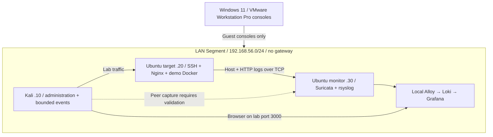

# Personal Cyber Lab

[Full repository tree](docs/repository-tree.md) ·
[Vietnamese handoff](docs/handoff.vi.md)


A local defensive cybersecurity portfolio project: build an isolated VMware Workstation Pro
network, harden a target, collect host/network telemetry, detect educational
events, investigate them and produce a private incident report.

[Tiếng Việt](README.vi.md) · [Installation](docs/installation.md) ·
[Validation results](docs/validation-results.md) · [Publication audit](PUBLICATION_AUDIT.md)

[VMware setup and migration guide in Vietnamese](docs/vmware.vi.md)

**Implementation is provided; live guest deployment and detection are unverified.**
No VM was created by this project session. Tests never substitute fixture data for
real observations. See the measured checks and pending VM work in the validation
results. Publication requires the owner's final privacy/dependency review.

## Architecture



NAT adapter 1 is used temporarily for installation, then disconnected. Adapter 2
is a shared LAN Segment. Verify monitor capture with an actual peer URL alert. There is no direct
Windows browser access in the default design. Understand the boundaries in
[network-design.md](docs/network-design.md) before running any live command.

## Features

- Shared validated YAML configuration, explicit private guest allowlist and
  strict guest/route checks before live traffic.
- Key-based SSH, source/interface-restricted UFW, private Docker port bindings,
  limited container resources and no default dashboard credential.
- Harmless demo endpoints: `/`, `/health`, `/login-demo`, `/api/status` and three
  educational URL markers. Demo login always rejects; no accounts are stored.
- Suricata EVE with eight documented classroom signatures, target auth/system/
  Nginx forwarding and a local Loki/Alloy pipeline.
- Fourteen provisioned Grafana panels for timelines, alerts, IPs, protocol,
  classification priority, SSH rejection lines and HTTP evidence.
- Bounded ICMP/TCP/discovery/HTTP/SSH/URL exercises, all with a network-free dry-run.
- Modular `cyberlab-cli`, private escaped HTML reports, synthetic examples,
  incident-response exercise and safe static CI.
- A lightweight mode that retains IDS and central files while omitting the
  dashboard stack. No cloud account, subscription or analytics integration.

## Requirements and topology

Host: Windows 11, VMware Workstation Pro, Git, VS Code, PowerShell; approximately 16 GiB RAM
and 75+ GiB free disk including snapshots. Python 3.12+ supports offline checks.
Guests: Kali and two Ubuntu Server 24.04 LTS machines. Use current security
updates; configuration examples do not contain personal host settings.

| Role | Example IP | Standard RAM / CPU | Main services |
| --- | --- | --- | --- |
| Kali | 192.168.56.10 | 2 GiB / 2 vCPU | Ansible, Python CLI, lab browser |
| Target | 192.168.56.20 | 2 GiB / 1 vCPU | SSH 22, Nginx 80, loopback demo 8080 |
| Monitor | 192.168.56.30 | 3 GiB / 2 vCPU | SSH 22, syslog 514/TCP, Grafana proxy 3000 |

Technologies: VMware Workstation Pro, Linux, TCP/IP, UFW, OpenSSH, Nginx, Docker Compose,
rsyslog, Suricata, Grafana Alloy/Loki/Grafana, Bash, PowerShell, Python and Ansible.
See [architecture.md](docs/architecture.md) for lightweight sizing and
[dependencies.md](docs/dependencies.md) for package/image review.

## Quick start: offline preview

These commands validate code/config and use **synthetic** fixtures only. They do
not provision guests or prove detection. From the project folder in PowerShell:

```powershell
python -m venv .venv
.\.venv\Scripts\python.exe -m pip install -e '.[dev]'
.\.venv\Scripts\python.exe cyberlab.py validate-config
.\.venv\Scripts\python.exe cyberlab.py hosts
.\.venv\Scripts\python.exe cyberlab.py simulate urls --dry-run
.\.venv\Scripts\python.exe cyberlab.py alerts --sample
.\.venv\Scripts\python.exe cyberlab.py report --sample
.\.venv\Scripts\python.exe -m pytest
```

The sample HTML report is [explicitly synthetic](reports/examples/synthetic-report.html).
Live reports are written only to ignored `reports/private/`. Never publish a real
log/report to make a portfolio look more complete.

## Build the actual lab

1. Follow [installation.md](docs/installation.md): manually create VMs, attach
   the isolated network, assign private interfaces and enroll verified SSH keys.
2. Run Ansible from Kali during an update window; deploy the target demo and,
   in standard mode, initialize the monitor stack with a unique local password.
3. Disconnect NAT on **all** guests, review VMware Workstation Pro settings and run preflight.
4. Run the diagnostic wrapper, then one reviewed exercise from Kali.
5. Verify packet counters, target logs, EVE signatures and Loki queries using the
   [detection guide](docs/detection-guide.md).
6. Complete the [incident investigation](docs/incident-response.md), keep raw
   evidence private and write a sanitized portfolio explanation.

Example, **inside Kali after setup and isolation review**:

```bash
python3 cyberlab.py preflight --confirm-isolated
bash scripts/validate-lab.sh --confirm-isolated
python3 cyberlab.py simulate urls --dry-run
python3 cyberlab.py simulate urls --confirm-isolated
```

Expected educational signal: `/admin-test` can match Suricata SID `1000004`.
Verify it in the monitor EVE file and Grafana before saying it was detected.
Successful traffic generation alone does not prove packet visibility or ingestion.

## Repository

```text
config/        shared lab configuration
configs/       Kali, target, monitor, SSH and firewall templates
ansible/       inventory, playbook, roles and validation handlers
cyberlab/      CLI, safety gates, services, parsers, reports and demo application
docker/        restricted target and monitoring Compose stacks
detection/     Suricata configuration, rules and synthetic fixtures
dashboards/    Grafana dashboard and provisioning code
scripts/       host checks, guest setup, simulations, diagnostics and audits
tests/         offline regressions and explicitly opt-in live guest checks
docs/          architecture, installation, investigation and portfolio guides
reports/       report template and labelled synthetic HTML example
.github/       static CI and dependency update configuration
```

The [complete candidate file list](PUBLICATION_FILES.txt) is generated without
staging files. [SECURITY.md](SECURITY.md) and the
[publication checklist](PUBLICATION_CHECKLIST.md) define the public/private boundary.

## Screenshots and portfolio evidence

No real screenshots are included automatically. Follow
[screenshots.md](docs/screenshots.md) for recommended captures and redaction.
Dashboard JSON is the source artifact; screenshots support an observed exercise.
Do not display personal usernames, tabs, notifications, tokens, MACs or host paths.

## Learning outcomes and next steps

Demonstrate virtualization, Linux administration, segmentation, least privilege,
SSH hardening, Docker, host/network log collection, IDS rule reasoning, event
correlation, incident investigation, Python/Bash/PowerShell automation and Git
publication hygiene. Explain what the sensor can see and where evidence is missing.

Trouble connecting or missing alerts? Use [troubleshooting.md](docs/troubleshooting.md)
and verify each hop separately. Three v2 options: authenticated TLS log transport,
additional Windows endpoint telemetry, and deterministic offline packet replay
inside the lab with carefully reviewed synthetic captures.

## Safety and license

Use only the private, isolated, authorized VMware Workstation Pro lab. No public or third-party
targets, exploitation, malware, credential theft, persistence or destructive
payloads are included. CLI simulations reject domains and out-of-scope hosts and
are never executed against real networks in CI. Read [SECURITY.md](SECURITY.md).

Source is licensed under [MIT](LICENSE); third-party components retain their own
licenses. No GitHub push or publication is performed automatically.
