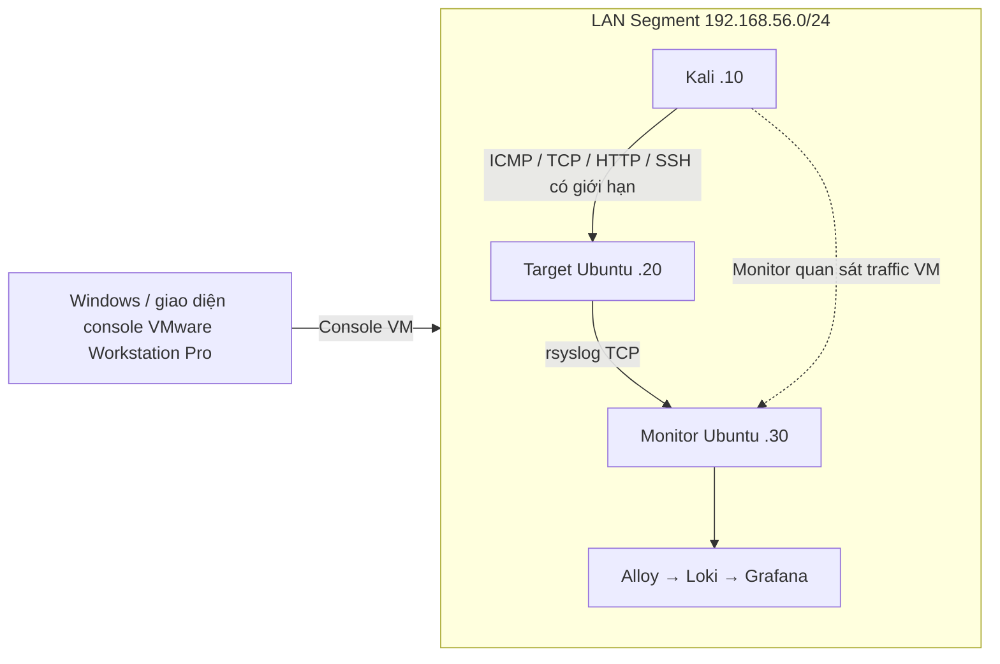

# Personal Cyber Lab


Project portfolio về phòng thủ an ninh mạng trên VMware Workstation Pro: dựng mạng cô lập,
cấu hình máy mục tiêu, thu thập telemetry, phát hiện sự kiện mẫu, điều tra và
viết báo cáo. [English](README.md) · [Hướng dẫn cài đặt](docs/installation.md) ·
[Kết quả kiểm tra](docs/validation-results.md)

[Bàn giao và các bước tiếp theo](docs/handoff.vi.md) ·
[Cây repository đầy đủ](docs/repository-tree.md)

**Bạn dùng VMware:** xem [cài đặt, cập nhật VM hiện có và test từng bước](docs/vmware.vi.md).

**Ba VM đã được triển khai; bằng chứng người dùng cung cấp xác nhận validator
Monitor đạt đủ 15 PASS.** Đã có quan sát URL marker, SSH rejection và bài
discover/HTTP. Kiểm tra source trên Windows đạt **129 PASS, 6 test live SKIP**.
Ảnh/log thật được giữ private; dữ liệu ví dụ vẫn có nhãn synthetic. Xem
[kết quả và giới hạn kiểm chứng](docs/validation-results.md), gồm các mục còn chờ
như Ansible idempotence và hosted CI. Project không tự tạo VM, thay đổi mạng
Windows hoặc push GitHub.

## Kiến trúc và tài nguyên



Adapter 1 dùng NAT tạm thời để cài package/image; ngắt cáp trước bài tập. Adapter 2
là LAN Segment cùng tên `cyberlab-internal`, không có gateway/DNS. Suricata yêu cầu capture promiscuous trên NIC lab của monitor. Phải kiểm tra
alert URL từ Kali tới Target để chứng minh monitor thấy traffic giữa hai VM;
bộ đếm packet hoặc log syslog nhận được chưa đủ để kết luận.

| VM | IP mẫu | RAM / vCPU chuẩn | Vai trò |
| --- | --- | --- | --- |
| LAB-KALI | 192.168.56.10 | 2 GiB / 2 | Quản trị Ansible, tạo sự kiện, trình duyệt lab |
| LAB-TARGET | 192.168.56.20 | 2 GiB / 1 | SSH, Nginx, Docker demo, system/auth log |
| LAB-MONITOR | 192.168.56.30 | 3 GiB / 2 | Suricata, rsyslog, dashboard |

Tổng RAM VM khoảng 7 GiB trên host 16 GiB. Máy yếu có thể đặt `lab.mode: lightweight`
trong `config/lab.yml`; vẫn có IDS và log tập trung, bỏ stack dashboard để tiết
kiệm RAM. Xem [architecture.md](docs/architecture.md) và
[network-design.md](docs/network-design.md). LAN Segment không cho Windows
truy cập trực tiếp vào VM; mở Grafana bằng trình duyệt **trong Kali**.

## Chức năng

- Cấu hình subnet/IP/interface/port tập trung, từ chối subnet rộng hoặc địa chỉ
  không thuộc danh sách ba VM. Không chấp nhận domain Internet hoặc redirect HTTP.
- SSH bằng key đã xác minh fingerprint, UFW giới hạn nguồn/interface, Docker chạy
  bằng user hạn chế và chỉ publish loopback. Không có mật khẩu mặc định Grafana.
- Demo HTTP có `/`, `/health`, `/login-demo`, `/api/status` và ba path marker.
  Login demo luôn bị từ chối, không lưu tài khoản hay mật khẩu.
- Suricata EVE, 8 rule giáo dục có giải thích, rsyslog chuyển auth/system/Nginx log
  và pipeline Alloy/Loki cục bộ. Grafana có 14 panel cấu hình dưới dạng JSON.
- Sáu mô phỏng nhỏ: ping, TCP, discovery vài port, HTTP burst, SSH bị từ chối và
  URL marker. `--dry-run` không tạo socket hay gửi packet.
- CLI đọc alert và tạo báo cáo HTML đã escape nội dung log. Báo cáo thật chỉ nằm
  ở `reports/private/`, được Git bỏ qua. Không gửi analytics hay upload log.
- Test offline, test VM opt-in, CI kiểm tra tĩnh và publication audit bảo vệ
  quyền riêng tư. Không chạy mô phỏng mạng thật trên GitHub Actions.

## Bắt đầu bằng kiểm tra offline

Cần Python 3.12+, Git và PowerShell. Các lệnh sau dùng cấu hình/fixture mẫu;
chưa cấu hình máy ảo hay chứng minh pipeline hoạt động:

```powershell
python -m venv .venv
.\.venv\Scripts\python.exe -m pip install -e '.[dev]'
.\.venv\Scripts\python.exe cyberlab.py validate-config
.\.venv\Scripts\python.exe cyberlab.py hosts
.\.venv\Scripts\python.exe cyberlab.py status
.\.venv\Scripts\python.exe cyberlab.py simulate urls --dry-run
.\.venv\Scripts\python.exe cyberlab.py alerts --sample
.\.venv\Scripts\python.exe cyberlab.py report --sample
.\.venv\Scripts\python.exe -m pytest
```

[Báo cáo HTML mẫu](reports/examples/synthetic-report.html) có nhãn **SYNTHETIC
EXAMPLE** và timestamp giả cố định. Nếu không có VM, test thật hiển thị
`SKIPPED - requires running cyber lab.` Kết quả đã thực sự chạy được ghi trong
[validation-results.md](docs/validation-results.md).

## Quy trình triển khai thật

1. Tự tạo Kali và hai Ubuntu Server 24.04 LTS, phân bổ tài nguyên và cấu hình
   adapter theo [installation.md](docs/installation.md). Dùng image chính thức.
2. Từ console VM, xác định tên NIC và cập nhật `config/lab.yml`. Cấu hình IP tĩnh;
   không đặt gateway cho NIC lab. Đổi mật khẩu mặc định của image import.
3. Tạo key riêng cho lab ngoài repo, xác minh fingerprint bằng console và thử SSH
   trước khi chạy Ansible. Không commit cả public key lẫn private key cá nhân.
4. Trong cửa sổ NAT phục vụ cài đặt, chạy Ansible từ Kali; khởi động demo trên
   target và stack giám sát trên monitor. Mật khẩu Grafana nhập kín, lưu local.
5. Ngắt NAT trên cả ba VM, kiểm tra lại topology và chạy preflight từ Kali.
6. Tạo một marker, kiểm tra từng bước log → EVE → Loki → dashboard rồi điều tra.

Ví dụ **trong Kali sau khi đã cô lập lab**:

```bash
python3 cyberlab.py preflight --confirm-isolated
bash scripts/validate-lab.sh --confirm-isolated
python3 cyberlab.py simulate urls --dry-run
python3 cyberlab.py simulate urls --confirm-isolated
```

Path `/admin-test` dự kiến khớp SID `1000004`; phải quan sát EVE và dashboard thật
trước khi nói detection thành công. Xem
[detection-guide.md](docs/detection-guide.md),
[logging.md](docs/logging.md) và [incident-response.md](docs/incident-response.md).
Suricata không đọc được nội dung xác thực SSH đã mã hóa; kết luận đăng nhập dựa
vào auth log. Số dòng rejection không đồng nghĩa số lần thử hoặc số incident.

## Tài liệu và cấu trúc

`config/` giữ cấu hình chung; `configs/` chứa template guest; `ansible/` tự động
cấu hình dịch vụ; `docker/` có Compose; `detection/` giữ rule và fixture synthetic;
`dashboards/` giữ Grafana JSON; `cyberlab/` là CLI; `scripts/` chứa setup/diagnostic/
audit; `tests/` có test offline và VM; `reports/` có template và ví dụ an toàn.
[Danh sách file công khai dự kiến](PUBLICATION_FILES.txt) không tự stage dữ liệu.

Lỗi thường gặp được giải thích trong [troubleshooting.md](docs/troubleshooting.md).
Ảnh portfolio nên thể hiện topology, rule detection, dashboard và investigation;
[screenshots.md](docs/screenshots.md) chỉ hướng dẫn chụp và kiểm tra riêng tư, không
tự thêm ảnh thật. [Threat model](docs/threat-model.md) giải thích ranh giới tin cậy.

## Trước khi đưa lên GitHub

Chốt bản đang chạy theo [hướng dẫn đồng bộ source và Git](docs/finalize.vi.md).
Dùng [kịch bản demo](docs/demo.vi.md) để trình diễn theo thứ tự và ghi bằng chứng.

Đọc [SECURITY.md](SECURITY.md), [PUBLICATION_CHECKLIST.md](PUBLICATION_CHECKLIST.md)
và [PUBLICATION_AUDIT.md](PUBLICATION_AUDIT.md). Không commit `.env`, key, token,
log thật, PCAP, database dump, report nhạy cảm hoặc ảnh chưa kiểm tra. `.gitignore`
không bảo vệ file đã được track; review cả lịch sử Git. Nếu phát hiện secret,
rotate/revoke và làm sạch history trước khi public. Bạn tự thực hiện push sau
khi review; project không tự publish.

Project giúp luyện Linux, network segmentation, logging, IDS, điều tra incident,
automation và tư duy bảo mật. Ba hướng v2: TLS xác thực cho log transport, telemetry
Windows endpoint và replay traffic tổng hợp đã kiểm tra trong lab. Chỉ sử dụng
trong lab riêng được ủy quyền; không nhắm public IP, khai thác hệ thống bên thứ ba
hay tạo malware. Mã nguồn dùng [giấy phép MIT](LICENSE).
