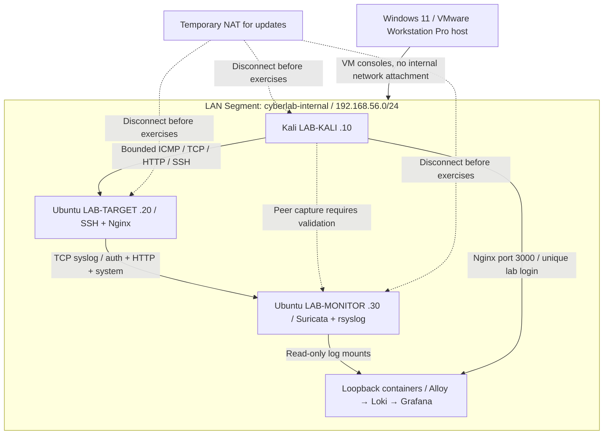

# Architecture

The lab exercises a complete defensive workflow: provision guests, generate a
bounded event, observe packets and host logs, identify an educational signature,
query the event in Grafana, and write an evidence-based incident report.

## Resource plan

| Guest | Standard RAM / vCPU / disk | Lightweight RAM / vCPU / disk |
| --- | --- | --- |
| Kali | 2 GiB / 2 / 25 GiB dynamic | 1.5 GiB / 1 / 20 GiB |
| Target | 2 GiB / 1 / 20 GiB dynamic | 1 GiB / 1 / 15 GiB |
| Monitor | 3 GiB / 2 / 30 GiB dynamic | 1.5 GiB / 1 / 20 GiB |

Standard guests reserve 7 GiB, leaving roughly 9 GiB on a 16 GiB host for Windows
and tools. Virtual CPUs are scheduled rather than dedicated; lower allocations
if your host has few cores. Set `lab.mode: lightweight` to omit the Loki/Alloy/
Grafana deployment while retaining Suricata and central files. Use CLI alerts
and HTML reports in that mode. Boot Kali with a lightweight desktop; close extra
applications. Logs rotate and Loki retains 72 hours, but still monitor disk use.

## Components and observations

| Component | Purpose / visibility | Verification |
| --- | --- | --- |
| Nginx | Lab HTTP entry point; structured requests and errors, no query/body logging | `/health`, `nginx -t`, access log |
| Demo container | Harmless endpoints; no authentication store or credentials | Loopback health check, container status |
| OpenSSH | Key-based guest administration; authentication events | `sshd -t`, invalid-user exercise |
| rsyslog | Forward target auth/system/Nginx logs; receive only the target | `rsyslogd -N1`, marker at both ends |
| Suricata | Passive private-interface sensor; EVE alert/HTTP/DNS/flow/stats | `suricata -T`, EVE packet stats and lab signatures |
| Alloy | Read only selected monitor files; retain read offsets | Container logs; Loki query after marker |
| Loki | Single binary file-backed log storage, internal container access | Local readiness and query checks |
| Grafana | Provisioned dashboard over Loki | Lab-only UI, query and event time range |

Nginx and Suricata see HTTP metadata; SSH content is encrypted, so authentication
outcomes come from auth logs. DNS EVE records appear only if DNS actually exists
in the isolated network; this design has no Internet DNS simulation. Neither a
green dashboard nor an IDS alert proves an intrusion or successful access.
