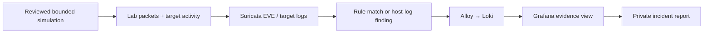

# Prove the event-to-dashboard workflow

These steps require actual running guests. Empty dashboards and static JSON
validation do not establish monitoring health. Start with a configured snapshot,
review isolation, verify clocks and use a narrow UTC investigation window.
Disconnect NAT and disable Shared Folders, clipboard and drag-and-drop on all
guests before generating traffic. Finish source/evidence transfer first; reopening
host sharing ends the isolated exercise window. See [the finalization guide](finalize.vi.md).



## Baseline and local validators

On Kali run `bash scripts/validate-lab.sh --confirm-isolated`. This checks the
assigned Kali address, target/monitor ICMP and required guest service health.
It does not automatically mark Suricata or ingestion as healthy.

On monitor inspect `sudo systemctl status cyberlab-suricata` and run
`sudo -u suricata suricata -T -c /etc/suricata/cyberlab.yaml`. `ip -br address`
must identify the configured monitor private NIC on the shared LAN Segment.
Workstation capture visibility must be measured using Kali-to-target URL alerts.
If only monitor-addressed traffic appears, inspect the configured capture NIC
and the segment attachment; packet counters alone cannot prove peer visibility.

The lab sensor captures IPv4 with `bpf-filter: "ip and not ip multicast"`.
IPv6 and IPv4 multicast are outside this exercise capture scope and will not
appear in new EVE records. This includes IPv6 multicast membership traffic and
IPv4 multicast service discovery. The filter preserves IPv4 ICMP, TCP and UDP
traffic used by the lab exercises. It does not restrict IPv4 unicast to the three
configured hosts; the parser still rejects unexpected source/destination IPs.
Isolation checks still inspect both IPv4 and IPv6 default routes. Expanding the
lab to IPv6 or multicast requires revisiting capture and evidence validation.
See [Suricata capture filters](https://docs.suricata.io/en/suricata-7.0.14/performance/ignoring-traffic.html).

## HTTP marker and packet proof

On Kali:

```bash
python3 cyberlab.py simulate urls --dry-run
python3 cyberlab.py simulate urls --confirm-isolated
```

On monitor:

```bash
sudo python3 cyberlab.py alerts --eve /var/log/suricata/eve.json --limit 20
```

Look for SIDs 1000004–1000006, source `.10`, destination `.20`, configured HTTP
port and a recent timestamp. Inspect EVE `stats.capture.kernel_packets` and
`kernel_drops`: counters must change after the exercise. Flow/HTTP events alone
do not prove the custom rule was loaded. Counters without matching traffic can
describe unrelated lab packets; correlate the marker and addresses.

On target, check `cyberlab-access.jsonl` for each marker path and status 200.
Monitor central `nginx-access.jsonl` should receive the same HTTP records. Retain
actual evidence privately; do not paste the files into the public repository.

## Host log transport marker

At the **target** console:

```bash
logger -p authpriv.notice -t cyberlab 'CYBERLAB synthetic pipeline marker'
```

This is a locally authored harmless marker, forwarded by the deployed target
configuration. Check local auth.log, then central `auth.jsonl`. Wait up to 30
seconds for the collector. On monitor, within ten minutes:

```bash
sudo python3 scripts/monitoring/validate-local.py --confirm-isolated
```

The validator checks guest service state, fresh EVE counters, URL signatures,
central auth/HTTP markers and queries those exact markers through the local
Grafana datasource proxy to Loki. It reads the local lab password without
printing it. Its loopback control-plane request is made only after monitor
identity/isolation validation; it sends no external request. Missing/stale data
or broken authentication/querying returns FAIL. Lightweight mode skips only the
dashboard step, keeping file/evidence checks.

## Grafana evidence

Open `http://192.168.56.30:3000` in Kali; use the unique local `labadmin` password.
Explore queries:

```logql
{job="suricata",event_type="alert"} | json | alert_signature_id="1000004"
{job="target",kind="nginx_access"} | json | path="/admin-test"
{job="target",kind="auth"} |= "CYBERLAB synthetic pipeline marker"
{job="target",kind="auth"} |~ "Invalid user|Failed |Accepted "
```

The dashboard provides recent raw evidence alongside aggregate charts. Check the
Loki timestamp and embedded event timestamp, input parsing errors and ingestion
lag. Numbers count records within the query window; they do not prove unique
incidents. Signature priority is not a final incident severity assessment.

For SSH, run the three-attempt rejected-auth scenario only after fingerprint
enrollment. Correlate invalid-user/preauth messages with TCP flows. Suricata
cannot decrypt SSH credentials or distinguish authentication outcomes from
network metadata. Do not claim SID 1000003 is a password-failure detector.

## Evidence matrix to complete

| Exercise | Traffic observed | Target log | EVE SID/counter | Loki query | Dashboard | Result |
| --- | --- | --- | --- | --- | --- | --- |
| Ping | Pending | Not an auth event | Pending 1000001 | Pending | Pending | Unverified |
| Small discovery | Pending | May have preauth notice | Pending 1000002 | Pending | Pending | Unverified |
| URL markers | Pending | Pending HTTP 200 | Pending 1000004–6 | Pending | Pending | Unverified |
| SSH rejection | Pending | Pending invalid/preauth | Connection metadata only | Pending auth query | Pending | Unverified |

Replace pending entries only after measuring them in your own lab. Record checks
that fail or cannot run with the required skip wording from [testing.md](testing.md).
