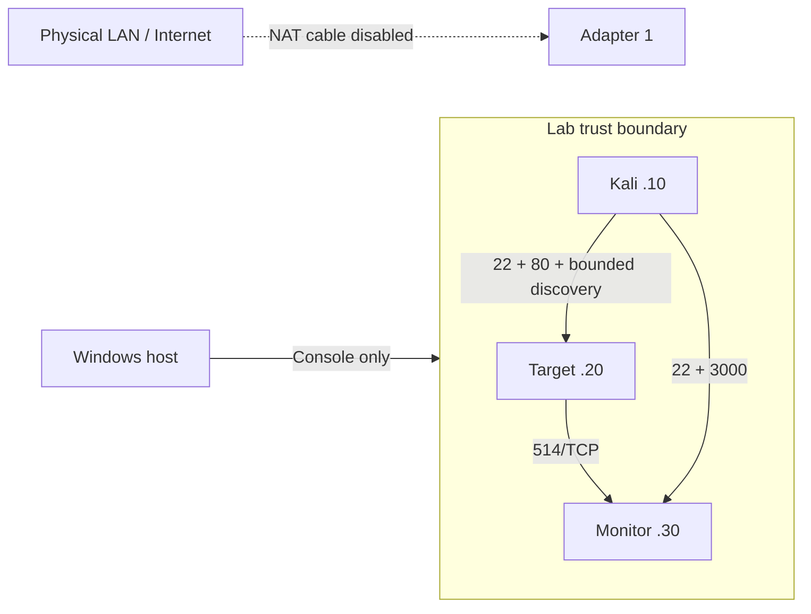

# Network design and isolation

| Mode | Communication | Advantage | Boundary / disadvantage |
| --- | --- | --- | --- |
| NAT | Guest outbound through VMware Workstation Pro | Easy package updates | Gives Internet egress; disable before testing; no port forwards |
| Host-only (VMnet1 by default) | Guests and Windows virtual adapter | Convenient host SSH/browser | Windows becomes reachable; firewall review required |
| LAN Segment | Only VMs with the same network name | Stronger separation from host/LAN | Administer from consoles or Kali; no direct Windows browser access |
| Bridged | Guests on the physical LAN | Useful in other deployments | Outside this project's isolation model; do not use |

Default: adapter 1 is NAT with **Connected** and **Connect at power on** unchecked after setup; adapter
2 is LAN Segment named `cyberlab-internal`. Use static IPs without a gateway
or DNS on adapter 2. Verify the guest interface names with `ip -br link` instead
of assuming the example names. Update `config/lab.yml` accordingly.

A LAN Segment is a private network shared by the selected VMs, without a Windows
host adapter or DHCP server. Configure static addresses manually. Use the same
segment name on all three VMs; naming an adapter alone does not attach it.

Suricata's AF_PACKET configuration requests promiscuous capture on the monitor's
private NIC. Capture of Kali-to-target unicast must be verified on the installed
Workstation version. Require a fresh URL marker SID with Kali source, target
destination and configured HTTP port; broadcast traffic and incoming syslog are
insufficient. See [detection-guide.md](detection-guide.md). This repository has
not measured peer capture on your VMware guests.

If the marker reaches Nginx but not Suricata, stop the detection acceptance check,
verify capture NIC/rules and LAN Segment attachment, then investigate the
Workstation capture path. Broadcom's `/dev/vmnet` permission guidance applies to
**Linux hosts**; this lab uses Windows. ESXi port-group security settings are also
specific to ESXi. Do not apply either recipe to Windows Workstation.

## Firewall boundary

- Target: incoming deny by default; permit SSH and HTTP from the Kali address on
  the lab interface. Nginx binds the target lab address; the demo container binds
  loopback port 8080 only.
- Monitor: permit SSH and Grafana proxy from Kali; syslog only from target on the
  lab interface. Loki/Alloy have no published ports; Grafana binds loopback 3300.
- Kali: administration uses the lab source IP. Tests bind sockets and subprocess
  traffic to it; routes with a gateway or any default route are rejected.
- Forwarding is disabled on Kali. Docker guests may need IPv4 forwarding for
  container networking, so UFW rejects routed traffic and no guest acts as a lab
  gateway. Do not add bridges, NAT between guest adapters or default gateways.
- Published Docker ports can bypass UFW. Loopback bindings and host Nginx source
  restrictions are intentional; never replace them with `0.0.0.0` publications.

The demo and Grafana also join a separate `proxy` Docker bridge. Current Docker
Engine may accept published ports but leave them unmapped when a container joins
only internal networks. The proxy bridge disables IP masquerading and publishes
only the existing loopback ports; Loki and Alloy remain on the internal monitoring
network. The VM's NAT adapter must still be disconnected during exercises.

## Update window

Stop all exercises. In the powered-off VM's settings, enable NAT adapter 1 and
its Connected setting. Install/update packages and fetch pinned images. Avoid browsing or
using personal accounts from these guests. Disable the cable or adapter after
updates and reboot if a stale DHCP default route remains. Confirm both
`ip -4 route show default` and `ip -6 route show default` are empty on Kali.
Run `python cyberlab.py preflight --confirm-isolated` from Kali before testing.

Host-only is an optional manual variation, not the default. You must create the
host-only adapter and review Windows firewall rules yourself, avoid Windows ICS
or forwarding, keep host services inaccessible, and record the changed trust
boundary. The CLI still accepts only the three guest IPs. Prefer the Internal
Network until you can explain the added exposure.

Sources: [Broadcom networking modes](https://knowledge.broadcom.com/external/article/309842/understanding-networking-types-in-hosted.html),
[Workstation user guide including LAN Segments](https://techdocs2-prod.adobecqms.net/content/dam/broadcom/techdocs/us/en/pdf/vmware/desktop-hypervisors/workstation/vmware-workstation-pro-17-0.pdf),
[capture permissions on Linux hosts](https://knowledge.broadcom.com/external/article/315331),
[Docker packet filtering and UFW limitations](https://docs.docker.com/engine/network/packet-filtering-firewalls/).
