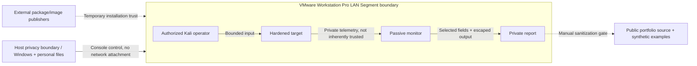

# Threat model

## Assets, actors and entry points

Assets: Windows host privacy, VM snapshots, lab SSH keys, unique Grafana secret,
guest availability, rule/config integrity and private evidence. Actors: the
authorized learner, an accidental misconfiguration, another lab guest/user, a
malicious dependency or untrusted input in network/log data. Entry points are
Nginx HTTP, SSH, the monitor syslog listener, log readers and container images.

## STRIDE review

| Category | Lab abuse scenario | Control | Residual risk |
| --- | --- | --- | --- |
| Spoofing | Fake target logs or SSH host | Enrolled host fingerprints, source-IP syslog filter | Syslog is not cryptographically authenticated; a privileged guest can spoof |
| Tampering | Altered rules, injected HTML in reports | Versioned source, validation, escaped text/CSP | Owner can still modify local source/config; audit is not a signature |
| Repudiation | Incomplete or altered event history | Independent host/EVE evidence, UTC timeline | No immutable evidence store; dropped/rotated logs create gaps |
| Information disclosure | Publish tokens, personal paths, real logs | Private directories, exact file review, Gitleaks, screenshot gate | Git ignores do not clean history; manual publication review is required |
| Denial of service | Excess requests or growing files | Count/rate/time/memory limits, Nginx limits, rotation/retention | Small budgets can still overload a low-memory guest |
| Elevation of privilege | Root container, Docker socket or weak SSH | Non-root containers, dropped caps, no socket, key-only SSH | Docker daemon/guest sudo still require trusted administration |
| Boundary escape | Bridged/NAT routing to external systems | LAN Segment, disconnected NAT, source binding and route checks | VM detection and private addresses do not attest the topology; inspect settings |

## Assumptions and evidence limits

The host owner controls VMware Workstation Pro, uses verified images and trusts the setup
operator. Administrator-level alteration of the guest/tools can defeat checks.
The lab is not a sandbox for unknown malware. Snapshots recover configuration but
do not prove evidence integrity or absence of compromise.

Plaintext HTTP/syslog permits classroom inspection only within this segment.
SSH content remains encrypted. Low thresholds and harmless URL markers have
false positives; a signature match is not exploitation. Packet capture requires
the correct private interface and verified peer unicast visibility. Coverage, clock skew,
parser warnings and buffer/rotation gaps must accompany any incident conclusion.
